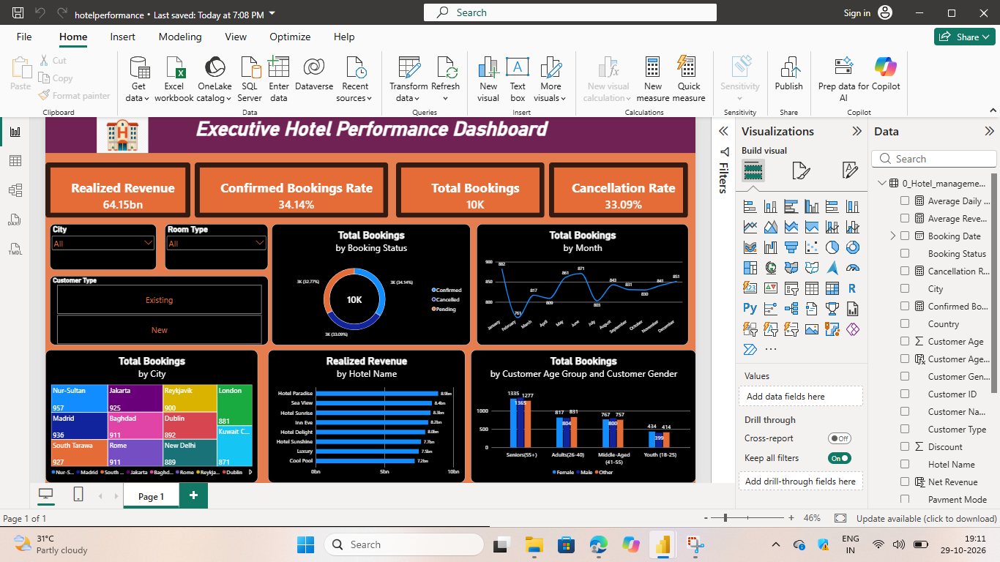

# Executive Hotel Performance Dashboard

## Project Overview

An interactive Power BI dashboard to explore hotel booking performance, revenue, booking status, monthly trends, cities, and customer demographics.



## Objectives

- Track key booking and revenue metrics.
- Compare confirmed, cancelled, and pending bookings.
- Explore booking trends by month and city.
- Compare revenue across hotels.
- Understand bookings by customer age group and gender.
- Filter by city, room type, and customer type.

## Tools Used

- Microsoft Power BI
- Power Query
- DAX

## Dataset

- Synthetic hotel booking dataset (CSV).
- 10,000 rows and 19 columns. The empty `Column1` was removed in Power Query, leaving 18 columns.
- Booking dates: Jan 2022 to Dec 2023.
- Fields include hotel, room type, city, payment mode, booking date, revenue, discount, booking status, and customer details.

## Data Cleaning

- Removed the empty `Column1` in Power Query.
- Checked for nulls and duplicates (none found).
- Created `Net Revenue` and `Customer Age Group` columns.

## Dashboard Highlights

### KPI Cards

| KPI | Value | Meaning |
|---|---|---|
| Realized Revenue | 64.15bn | Net revenue (after discount) from confirmed bookings |
| Confirmed Bookings Rate | 34.14% | Confirmed bookings ÷ total bookings |
| Total Bookings | 10K | All booking records |
| Cancellation Rate | 33.09% | Cancelled bookings ÷ total bookings |

### Visuals

- Donut chart: booking status
- Line chart: total bookings by month
- Treemap: total bookings by city
- Bar chart: realized revenue by hotel
- Column chart: bookings by customer age group and gender
- Slicers: City, Room Type, Customer Type

## Key Insights

- Bookings are split almost equally: 34.1% confirmed, 33.1% cancelled, 32.8% pending.
- Hotel Paradise earns the highest realized revenue (about 8.9bn), followed by Sea View and Hotel Sunrise.
- Nur-Sultan has the most bookings (957), followed by Madrid (936).
- January has the most bookings (882, combined across 2022 and 2023), followed by June (871).

## DAX Measures

```dax
Total Bookings =
COUNTROWS('0_Hotel_management Data')
```

```dax
Confirmed Bookings Rate =
DIVIDE(
    CALCULATE(
        COUNTROWS('0_Hotel_management Data'),
        '0_Hotel_management Data'[Booking Status] = "Confirmed"
    ),
    COUNTROWS('0_Hotel_management Data'),
    0
)
```

```dax
Cancellation Rate =
DIVIDE(
    CALCULATE(
        COUNTROWS('0_Hotel_management Data'),
        '0_Hotel_management Data'[Booking Status] = "Cancelled"
    ),
    COUNTROWS('0_Hotel_management Data'),
    0
)
```

Calculated column:

```dax
Net Revenue =
'0_Hotel_management Data'[Total Revenue] *
(1 - '0_Hotel_management Data'[Discount] / 100)
```

Measure:

```dax
Realized Revenue =
CALCULATE(
    SUM('0_Hotel_management Data'[Net Revenue]),
    '0_Hotel_management Data'[Booking Status] = "Confirmed"
)
```

## Data Notes

This dataset is synthetic, so some values are not realistic:

- City and Country do not match (for example, Kuwait City appears under Kiribati), so Country is not used in the analysis.
- Rooms booked is higher than rooms available in most rows.
- Every Customer ID is unique, so repeat customers cannot be tracked.

## How to Use

1. Open `hotelperformance.pbix` in Power BI Desktop.
2. Use the City, Room Type, and Customer Type slicers to filter.
3. Review the KPI cards and charts.
